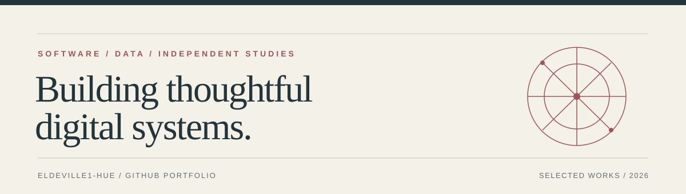
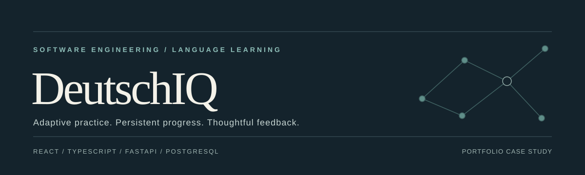
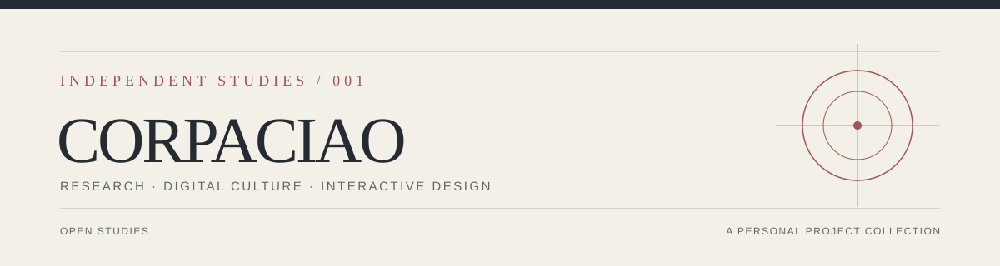
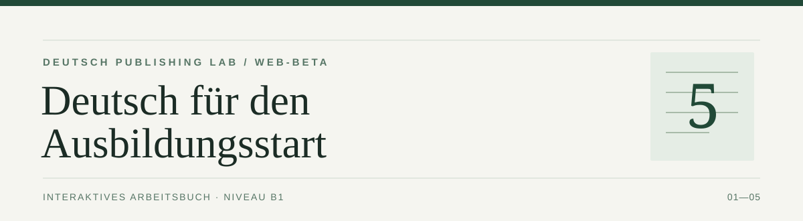

  

  <strong>Software development · Learning technology · Independent research</strong> 
  Building and refining practical digital products, with interests in data science, applied mathematics and human-centered interfaces.

  <a href="#selected-work">Selected work</a>
  &nbsp;·&nbsp;
  <a href="#engineering-practice">Engineering practice</a>
  &nbsp;·&nbsp;
  <a href="#current-direction">Current direction</a>

---

## Selected work

### 01 — [DeutschIQ](https://github.com/eldeville1-hue/deutschiq-ai-learning-platform)

**Adaptive German-learning platform · Full-stack application**

A Telegram Mini App bringing together language diagnostics, personalized practice, spaced review, progress tracking and AI-assisted feedback. Its engineering work spans frontend, API, persistent state, tests and deployment.

`React` · `TypeScript` · `Python` · `FastAPI` · `PostgreSQL` · `Docker`

[Explore the code](https://github.com/eldeville1-hue/deutschiq-ai-learning-platform) · [View the live application](https://deutschiq.onrender.com/) · [Read the case study](https://github.com/eldeville1-hue/deutschiq-ai-learning-platform/blob/main/docs/PORTFOLIO_CASE_STUDY.md)

### 02 — [CORPACIAO](https://github.com/eldeville1-hue/corpaciao)

**Independent studies · Interactive web experiences**

An evolving set of research-driven digital publications, including a night-sky atlas, a color-history experience and open research-methods materials. The repository also contains a separate Python workflow for auditing music metadata.

`HTML` · `CSS` · `JavaScript` · `SVG` · `Python`

[Explore the collection](https://github.com/eldeville1-hue/corpaciao) · [Night Sky Atlas](https://github.com/eldeville1-hue/corpaciao/tree/main/night-sky-atlas) · [Dataset audit](https://github.com/eldeville1-hue/corpaciao/blob/main/audit_cohorts.py)

### 03 — [Deutsch Publishing Lab](https://github.com/eldeville1-hue/deutsch-publishing-lab)

**Educational publishing · Interactive workbook**

An experimental German B1 learning workbook organized around applications, interviews and everyday communication during vocational training. Five chapters combine interactive tasks with browser-based progress tracking.

`HTML` · `CSS` · `JavaScript` · `Browser QA`

[Explore the workbook](https://github.com/eldeville1-hue/deutsch-publishing-lab) · [Editorial quality standards](https://github.com/eldeville1-hue/deutsch-publishing-lab/blob/main/docs/EDITORIAL_QUALITY_GATE.md)

---

## Engineering practice

Rather than treating projects as static demos, I work on the full cycle: **requirements → implementation → testing → documentation → iteration**.

| Area | Experience demonstrated in these repositories |
| :--- | :--- |
| Frontend | Responsive interfaces, React, TypeScript, browser-native web experiences |
| Backend | Python, FastAPI, REST endpoints, authentication and state validation |
| Data | PostgreSQL, SQLAlchemy, schema migrations and structured data processing |
| Quality | Automated tests, GitHub Actions and documented release checks |
| Delivery | Docker, Render and reproducible setup instructions |

I use AI-assisted tools as part of my development workflow and aim to validate, understand and document what I build. Feature claims and experimental results should be assessed against the accompanying code, tests and project documentation.

## Für Ausbildungsbetriebe / German-language overview

**Sie möchten meine Projekte für eine IT-Ausbildung kennenlernen?** Eine kompakte Übersicht auf Deutsch erklärt die drei öffentlichen Projekte, ihre Technologien und mögliche Fragen für ein technisches Gespräch.

[**Projektportfolio auf Deutsch ansehen →**](docs/IT_AUSBILDUNG_PORTFOLIO_DE.md)

---

## Current direction

I'm building experience in **software engineering and applied data work**, while strengthening the foundations of mathematics, Python and computer science. I am especially interested in developing tools that make complex information easier to learn, explore and use.

**Open to:** opportunities to learn, contribute and collaborate on technically meaningful projects.

---

Selected public projects from [eldeville1-hue](https://github.com/eldeville1-hue). Some products are in beta; individual README files document their current verification limits. Private repositories are intentionally excluded.
