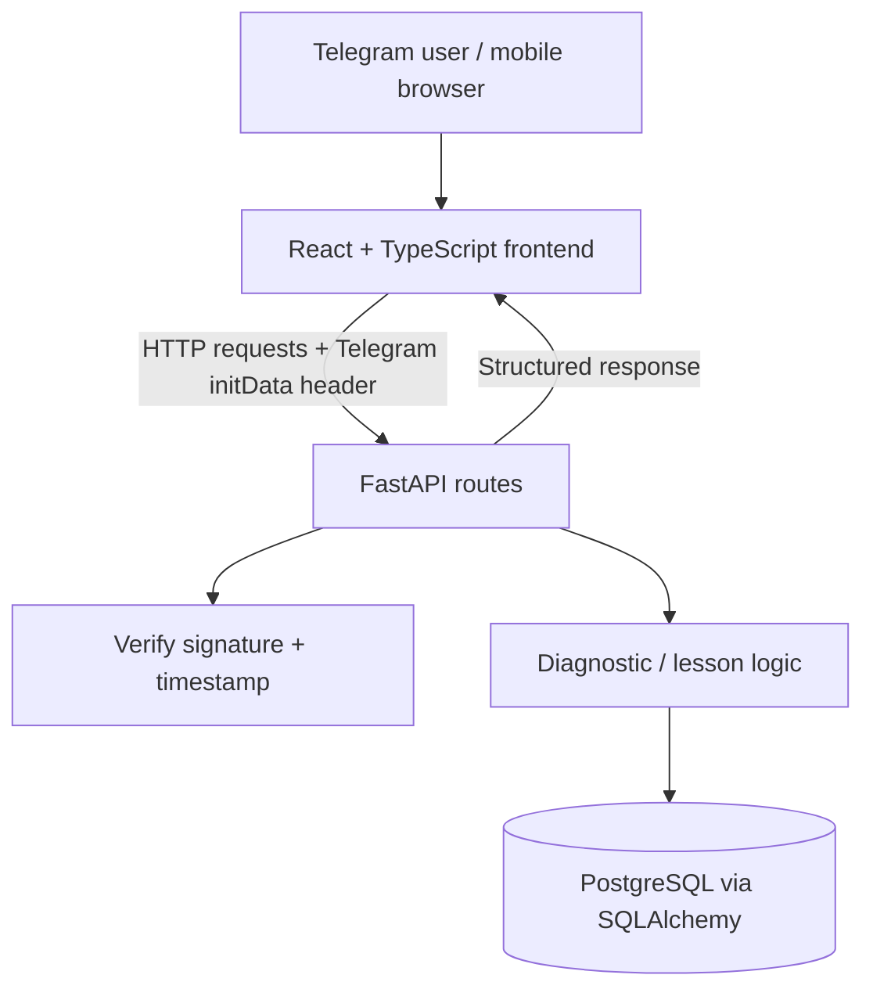

# DeutschIQ — Technisches Interview-Training

*Lernunterlage für eine Bewerbung als Fachinformatikerin für Anwendungsentwicklung. Stand: November 2026.*

Diese Unterlage ist **kein auswendig zu lernender Bewerbungstext**. Sie verbindet überprüfbare Stellen im öffentlichen Quellcode mit Fragen, praktischen Übungen und einfachen Erklärungen. Ziel: die Architektur verstehen, im Gespräch eigenständig demonstrieren und die Grenzen des eigenen Wissens offen benennen.

## 1. Das System in 60 Sekunden

> „DeutschIQ ist eine Lernanwendung für Deutsch im Telegram-Umfeld. Das Frontend ist mit React und TypeScript aufgebaut. Es kommuniziert über HTTP mit einem FastAPI-Backend in Python. Das Backend überprüft die Telegram-Anmeldung, verarbeitet Lernaktivitäten und speichert Lernstände mit SQLAlchemy in einer Datenbank. Tests und GitHub Actions helfen bei der Qualitätssicherung.“

**Selbstkontrolle:** Sprich diesen Text zuerst in eigenen Worten nach, dann erkläre ihn ohne Vorlage. Das Verständnis ist wichtiger als die Formulierung.

**Quellen:** [Frontend routes](https://github.com/eldeville1-hue/deutschiq-ai-learning-platform/blob/main/frontend/mini-app/src/App.tsx), [HTTP API client](https://github.com/eldeville1-hue/deutschiq-ai-learning-platform/blob/main/frontend/mini-app/src/services/api.ts), [Telegram authentication](https://github.com/eldeville1-hue/deutschiq-ai-learning-platform/blob/main/backend/app/core/telegram_auth.py), [database session](https://github.com/eldeville1-hue/deutschiq-ai-learning-platform/blob/main/backend/app/core/database.py).

## 2. Was passiert beim Öffnen einer Lernseite?

1. React zeigt anhand der URL eine Komponente an; zum Beispiel nutzt `App.tsx` eine Route `/lesson/:id`.
2. Der HTTP-Client aus `api.ts` sendet Anfragen an FastAPI. Ein Request-Interceptor fügt Telegram-`initData` zum Header `X-Telegram-Init-Data` hinzu, wenn diese Daten vorliegen.
3. Das Backend verwendet `telegram_user_id` als FastAPI-Abhängigkeit, um die Identität aus den signierten Daten zu prüfen.
4. Der Lesson-Endpunkt ruft die passenden Daten und Lernoperationen auf. Eine SQLAlchemy-Session wird über `get_db` bereitgestellt.
5. Das Ergebnis gelangt als HTTP-Antwort zurück ins Frontend.

**Achtung:** Die angezeigte Benutzer-ID darf nicht allein als Authentifizierung verwendet werden. Eine vom Browser behauptete ID ist etwas anderes als eine auf dem Server geprüfte Identität.

**Code entdecken:** [Lesson start endpoint](https://github.com/eldeville1-hue/deutschiq-ai-learning-platform/blob/main/backend/app/api/endpoints/lesson.py) — suche nach `StartLessonRequest`, `@router.post("/start")` und `assert_owner`.

### Übung A — selbst erklären

Erkläre, warum ein React-Frontend **nicht** direkt vertrauenswürdig entscheiden sollte, wem ein Lernstand gehört. Formuliere eine Antwort in drei Sätzen auf Deutsch und zeichne danach den Datenfluss ohne diese Vorlage.

## 3. Telegram-Authentifizierung wirklich verstehen

In `backend/app/core/telegram_auth.py` prüft die Funktion `verify_telegram_init_data`:

- ob ein Hash vorhanden ist und keine doppelten Query-Parameter übergeben wurden;
- ob der erwartete HMAC-Hash mit der empfangenen Signatur übereinstimmt;
- ob der Zeitstempel innerhalb des erlaubten Zeitfensters liegt;
- ob aus den signierten Daten eine Benutzer-ID gelesen werden kann.

Die Funktion `assert_owner` verhindert zusätzlich, dass eine korrekt authentifizierte Person eine andere `user_id` als ihre eigene beansprucht.

**Interviewfrage:** *Was ist der Unterschied zwischen Authentifizierung und Autorisierung?*

**Muster zum Überprüfen des Verständnisses:** Authentifizierung prüft, **wer** eine Person ist. Autorisierung prüft, **welche Daten oder Aktionen** dieser Person erlaubt sind. Im Code bestätigen die Signaturprüfung und der Besitzervergleich zwei unterschiedliche Schutzschritte.

**Wichtig:** Dieses Konzept ersetzt keinen vollständigen Sicherheitsaudit. Nutze bei einer Erklärung nur die tatsächlich geprüften Schutzmaßnahmen.

### Übung B — Sicherheitsfall

Eine Nutzerin sendet im Request `user_id=42`, die verifizierte Telegram-ID lautet aber `17`. Was soll der Server tun? Suche im Code, wo diese Situation geprüft wird, und erkläre, weshalb das Frontend allein sie nicht zuverlässig verhindern kann.

## 4. Datenbank und persistente Lernstände

Der Code in `backend/app/core/database.py` erzeugt mit SQLAlchemy eine Verbindung (*engine*) sowie eine `SessionLocal`-Fabrik. Die FastAPI-Abhängigkeit `get_db` öffnet eine Session für die Anfrage und schließt sie danach.

Im Lesson-Endpunkt werden unter anderem `User`, `Lesson`, `LearningSession` und `ExerciseAttempt` verwendet. Beim Start eines Unterrichts prüft die Anwendung vorhandene aktive Sessions und kann eine laufende Sitzung nach erneutem Öffnen fortsetzen.

**Interviewfrage:** *Warum eine Datenbank, wenn es auch localStorage im Browser gibt?*

Ein guter Einstieg: Browser-Speicher ist geräte- und browsergebunden und nicht dieselbe Quelle wie ein persistenter Server-Lernstand. Eine Datenbank ermöglicht serverseitige Zuordnung, Abfrage und Aktualisierung. Ergänzend nutzt der API-Client lokales Caching für ausgewählte Anfragen; das ist nicht die alleinige Quelle für Lernfortschritt.

**Code entdecken:** [database.py](https://github.com/eldeville1-hue/deutschiq-ai-learning-platform/blob/main/backend/app/core/database.py), [lesson.py](https://github.com/eldeville1-hue/deutschiq-ai-learning-platform/blob/main/backend/app/api/endpoints/lesson.py), [api.ts](https://github.com/eldeville1-hue/deutschiq-ai-learning-platform/blob/main/frontend/mini-app/src/services/api.ts).

### Übung C — Fehlersuche

Das Frontend zeigt nach dem Neuladen einen alten Lernstand an. Nenne drei mögliche Ursachen und für jede eine konkrete Prüfung. Hinweis: Unterscheide zwischengespeicherten Frontend-Daten, fehlgeschlagener Netzwerk-Anfrage und nicht gespeicherter Backend-Änderung.

## 5. Qualitätssicherung und GitHub Actions

Der Projektordner `backend/tests/` enthält automatisierte Tests. Der GitHub-Workflow `.github/workflows/ci.yml` ist der Einstieg für CI-Prüfungen. Das Profil selbst hat außerdem einen eigenen Workflow zur Prüfung von README-Bildern und Abschnittslinks.

**Interviewfrage:** *Was unterscheidet Unit-Test, Integrationstest und End-to-End-Test?*

- **Unit-Test:** untersucht eine kleine Funktion isoliert.
- **Integrationstest:** überprüft das Zusammenspiel von mehreren Komponenten, beispielsweise API und Datenbank.
- **End-to-End-Test:** führt einen realistischen Nutzerablauf über die sichtbare Anwendung aus.

**Keine Übertreibung:** Ein grüner CI-Status beweist nicht automatisch, dass jeder Lerninhalt didaktisch richtig ist oder dass die App auf jedem Smartphone fehlerfrei funktioniert.

### Übung D — Test schreiben

Schreibe einen Testfall als kurze Beschreibung:

**Given** eine gültige Telegram-Sitzung, **when** die Anmeldedaten verändert werden, **then** muss die Anmeldung abgelehnt werden. Suche anschließend in `backend/tests/test_security_hardening.py` nach einem vergleichbaren Test und erkläre, warum er wichtig ist.

## 6. Typische Interviewfragen — ohne auswendig gelernte Antworten

| Frage | Was du zeigen solltest | Wo nachsehen? |
| --- | --- | --- |
| „Was ist React?“ | Komponenten, Benutzeroberfläche, Routing | `frontend/mini-app/src/App.tsx` |
| „Was ist eine API?“ | HTTP-Anfrage, Endpunkt, JSON-Antwort | `frontend/mini-app/src/services/api.ts` |
| „Was macht FastAPI?“ | Python-Endpunkte und Abhängigkeiten | `backend/app/api/endpoints/lesson.py` |
| „Wie schützt ihr Nutzerkonten?“ | Signatur, Ablaufzeit, Besitzerprüfung | `backend/app/core/telegram_auth.py` |
| „Warum PostgreSQL?“ | gespeicherte Daten und Sessions | `backend/app/core/database.py` |
| „Wie prüfst du eine Änderung?“ | Reproduktion, Test, Pull Request, CI | `.github/workflows/ci.yml` |
| „Was hast du selbst verstanden?“ | eine konkrete Funktion Schritt für Schritt erklären | Wähle eine Code-Stelle selbst |

## 7. Fünf-Minuten-Demonstration

**00:00–00:45 — Problem:** Welches Lernproblem soll DeutschIQ lösen?

**00:45–01:45 — Oberfläche:** Zeige die Startseite und eine Lernfunktion. Falls die App nicht zugänglich ist, nutze die vorhandenen Screenshots und sage das offen.

**01:45–03:15 — Technik:** Gehe den Weg `React → HTTP → FastAPI → Datenbank` anhand einer konkreten Datei durch.

**03:15–04:15 — Qualität:** Zeige einen Test, erkläre dessen Erwartung und Grenzen.

**04:15–05:00 — Reflexion:** Nenne eine Schwierigkeit, einen überprüfbaren Lösungsversuch und einen nächsten Lernschritt.

## 8. Selbstbewertung vor dem Gespräch

Kreuze erst dann **verstanden** an, wenn du ein Thema ohne Vorlage erklären und mindestens eine passende Code-Stelle finden kannst.

- [ ] Ich kann Frontend, Backend und Datenbank unterscheiden.
- [ ] Ich kann zeigen, wie eine API-Anfrage aus React entsteht.
- [ ] Ich verstehe den Unterschied zwischen Authentifizierung und Autorisierung.
- [ ] Ich kann erklären, warum Lernstände serverseitig gespeichert werden.
- [ ] Ich kann den Zweck eines automatisierten Tests erklären.
- [ ] Ich kann bei einer unbekannten Frage ehrlich erklären, wie ich sie untersuchen würde.

**Lernreihenfolge:** Zuerst die Abschnitte 1–2, danach 3–4, dann 5–7. Lieber drei Punkte sicher erklären als zehn technische Begriffe aufzählen, die du noch nicht verstehst.

---

[Zur deutschen Portfolio-Übersicht](IT_AUSBILDUNG_PORTFOLIO_DE.md) · [Zum GitHub-Profil](https://github.com/eldeville1-hue) · [Zum DeutschIQ-Code](https://github.com/eldeville1-hue/deutschiq-ai-learning-platform)
